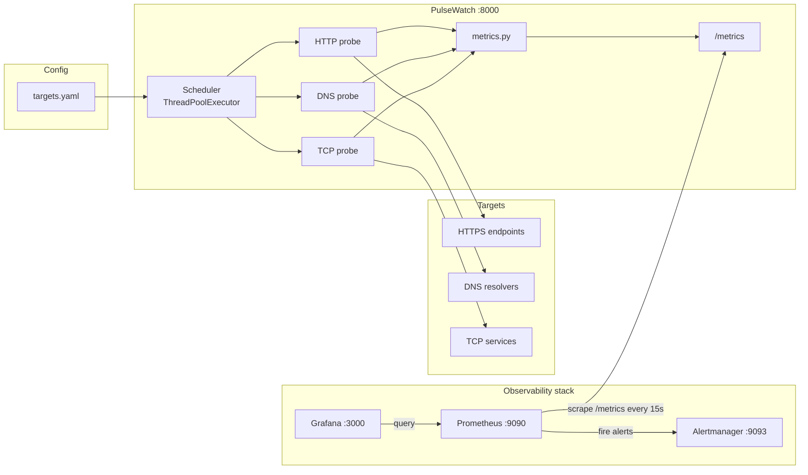

# PulseWatch

Service health and SLO monitor. Probes HTTP, DNS, and TCP targets on a schedule,
exposes Prometheus metrics, and ships with burn-rate alert rules and a Grafana dashboard.

---

## Architecture



---

## Quick start

```bash
python -m venv .venv
# Windows:
.venv\Scripts\activate
# macOS/Linux:
source .venv/bin/activate

pip install -e ".[dev]"
pulsewatch --config config/targets.yaml
```

Metrics: `http://localhost:8000/metrics`

---

## Configuration

Edit `config/targets.yaml`. All targets share the common fields; probe-specific fields
are required only for that type.

**Common fields**

| Field | Default | Description |
|---|---|---|
| `name` | required | Unique label used in all metric labels |
| `type` | required | `http`, `dns`, or `tcp` |
| `interval` | `30` | Seconds between probe runs |
| `timeout` | `10` | Seconds before a single attempt is aborted |
| `retries` | `2` | Extra attempts after a failure (0 = try once) |

**HTTP-specific**

| Field | Default | Description |
|---|---|---|
| `url` | required | Full URL including scheme (`https://...`) |
| `expected_status` | `200` | HTTP status code that counts as success |

**DNS-specific**

| Field | Default | Description |
|---|---|---|
| `host` | required | Hostname to resolve |
| `record_type` | `A` | DNS record type (`A`, `AAAA`, `CNAME`, `MX`, `TXT`, `NS`) |

**TCP-specific**

| Field | Default | Description |
|---|---|---|
| `host` | required | Hostname or IP |
| `port` | required | TCP port (1–65535) |

**Example**

```yaml
targets:
  - name: api-gateway
    type: http
    url: https://api.example.com/health
    interval: 15
    timeout: 5
    retries: 1
    expected_status: 200

  - name: primary-dns
    type: dns
    host: api.example.com
    record_type: A
    interval: 60
    timeout: 5
    retries: 1

  - name: postgres
    type: tcp
    host: db.internal
    port: 5432
    interval: 30
    timeout: 3
    retries: 0
```

---

## Running tests

```bash
pytest
```

Coverage gate is 85%. Run with `-v` for per-test output.

---

## Docker Compose (Prometheus + Grafana + Alertmanager)

```bash
cd deploy
docker compose up -d --build
```

| Service | URL |
|---|---|
| PulseWatch metrics | http://localhost:8000/metrics |
| Prometheus | http://localhost:9090 |
| Grafana | http://localhost:3000 (admin / admin) |
| Alertmanager | http://localhost:9093 |

The Grafana dashboard and Prometheus datasource are auto-provisioned — no manual
setup needed. The dashboard appears under Dashboards → "PulseWatch" within 30 seconds
of the first scrape.

To reload Prometheus config without restarting (e.g., after editing `alert_rules.yml`):

```bash
curl -s -X POST http://localhost:9090/-/reload
```

**Tear down:**

```bash
docker compose down        # stop containers
docker compose down -v     # also delete Prometheus and Grafana volumes
```

<!-- screenshot: docker-compose-ps.png -->
<!-- screenshot: grafana-dashboard.png -->

---

## Kubernetes (kind)

**Prerequisites:** Docker, [kind](https://kind.sigs.k8s.io), kubectl.

```bash
# create a local cluster
kind create cluster --name pulsewatch-dev

# build and load the image (kind has its own registry)
docker build -t pulsewatch:dev .
kind load docker-image pulsewatch:dev --name pulsewatch-dev

# apply manifests in order (numbered files sort correctly)
kubectl apply -f deploy/k8s/

# wait for rollout
kubectl rollout status deployment/pulsewatch -n pulsewatch --timeout=60s

# forward the metrics port
kubectl port-forward -n pulsewatch svc/pulsewatch 8000:8000
```

Verify: `curl http://localhost:8000/metrics`

**Useful commands:**

```bash
# pod status and probe results
kubectl get pods -n pulsewatch
kubectl describe pod -n pulsewatch -l app=pulsewatch

# live logs
kubectl logs -n pulsewatch -l app=pulsewatch -f

# update targets without rebuilding the image
kubectl edit configmap pulsewatch-targets -n pulsewatch
kubectl rollout restart deployment/pulsewatch -n pulsewatch
```

**Tear down:**

```bash
kind delete cluster --name pulsewatch-dev
```

<!-- screenshot: kubectl-get-pods.png -->

---

## Metrics reference

All metrics carry `target` and `probe_type` labels.

| Metric | Type | Description |
|---|---|---|
| `pulsewatch_probe_success` | Gauge | `1` if the last probe succeeded, `0` if it failed |
| `pulsewatch_probe_duration_seconds` | Histogram | Probe round-trip duration |
| `pulsewatch_probe_http_status_code` | Gauge | Last HTTP status code (HTTP probes only) |
| `pulsewatch_probe_tls_cert_expiry_days` | Gauge | Days until TLS certificate expiry (HTTPS only) |
| `pulsewatch_probe_total` | Counter | Total probe executions, with `result` label (`success`/`failure`) |

**Useful queries:**

```promql
# availability over the last 5 minutes per target
avg_over_time(pulsewatch_probe_success[5m]) * 100

# probe duration p95
histogram_quantile(0.95,
  sum by (le, target) (rate(pulsewatch_probe_duration_seconds_bucket[5m])))

# 30-day error ratio (requires at least 30d of data)
1 - (
  sum_over_time(pulsewatch_probe_success[30d]) /
  count_over_time(pulsewatch_probe_success[30d])
)
```

---

## SLO alerting

**SLO:** 99.5% of probe executions succeed over a 30-day window.

Alert rules are in [`deploy/prometheus/alert_rules.yml`](deploy/prometheus/alert_rules.yml).
See [`docs/slo.md`](docs/slo.md) for the full design rationale and fault injection walkthrough.

| Alert | Burn rate | Fires when | Severity |
|---|---|---|---|
| `ProbeDown` | — | target failing for > 2 min | warning |
| `ProbeBurnRateCritical` | 14.4× | budget exhausted in ~50h | critical |
| `ProbeBurnRateHigh` | 6× | budget exhausted in ~5d | warning |
| `ProbeBurnRateMedium` | 3× | budget exhausted in ~10d | warning |
| `ProbeBurnRateLow` | 1× | will miss SLO at current rate | info |

**Fault injection:** uncomment the `dead-service` target in `config/targets.yaml`,
restart PulseWatch, and watch `ProbeDown` fire within 2 minutes in Prometheus alerts.

---

## CI

GitHub Actions runs on every push and pull request:

1. **lint** — `ruff check .`
2. **test** — `pytest` with 85% coverage gate
3. **build-push** — Docker build on all branches; push to GHCR on `main` only

Image: `ghcr.io/<owner>/pulsewatch:latest`

---

## Known limitations

- Single-node only. Multiple replicas each probe all targets independently, which double-counts results in Prometheus. No distributed coordination is implemented.
- No `/health` endpoint separate from `/metrics`. Liveness and readiness probes check `/metrics`.
- TLS cert check opens a second connection after the HTTP probe. Adds ~100ms per HTTPS target.
- Probe counters reset to zero on restart. Prometheus retains scraped values, so the gap is bounded by PulseWatch's own downtime.
- No per-target SLO configuration. All targets share the 99.5% threshold.
- No authentication support for probed endpoints.
- SIGTERM handling works on Linux/macOS. On Windows, only SIGINT (Ctrl+C) is reliably delivered.
